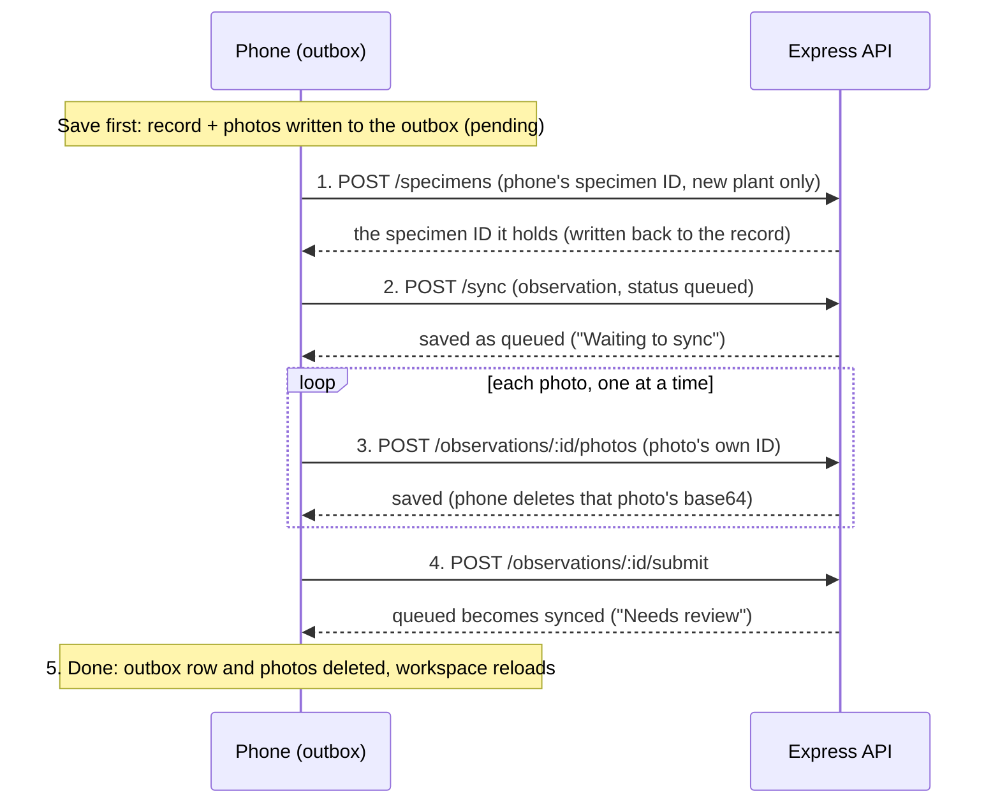

# Offline mode: how the phone saves and sends records

*Written 7 Nov 2026, branch `feature/CTIP-16-offline-mode`. Covers the mobile app, the
API (`POST /sync`) and the tag and species caches. This is the short plan the sprint asks
for before offline mode is built.*

A botanist in the field often has no signal. The app must never lose a record because of
that. The idea is simple:

1. **Save on the phone first, always.** The record and its photos go into an encrypted
   file on the phone before any network call.
2. **Send later, in a fixed order, safe to repeat.** If the connection drops half way,
   the next run carries on where it stopped and never makes a duplicate.
3. **Never decide for the botanist.** If a record was changed somewhere else, the app
   shows both copies and asks.

The rest of this page says how, what the botanist sees, and what we test.

**Stories covered**

| Story | Title | Where |
|---|---|---|
| CTIP-16 | Sync queue upload with idempotency keys (includes `POST /sync`) | This design; [§3](#3-ids-and-repeating-safely) and [§4](#4-sync-order) |
| CTIP-44 | Local-first record store | [§2](#2-save-first) |
| CTIP-83 | Offline capture in airplane mode | [§2](#2-save-first) |
| CTIP-84 | Cache species reference for offline search | [§10](#10-species-offline) |
| CTIP-66 | Resumable photo upload during sync | [§4](#4-sync-order) |
| CTIP-67 | Sync conflict handling for two devices | [§8](#8-conflicts) |
| CTIP-68 | Sync status and sync triggers | [§6](#6-local-states-what-the-botanist-sees) and [§11](#11-when-the-app-syncs) |
| CTIP-116 | Generate a QR tag offline (reserved tag IDs) | [§7](#7-tags-offline) |

---

## 1. Decisions already made

These were agreed with the Product Owner and are not open for debate in code review.

- **Offline work starts now (7 Nov 2026), with the Product Owner's approval, even though
  IoT is not finished.** Online plant capture already works end to end, so offline mode
  does not depend on the sensors.
- **Signing out keeps unsent records.** They stay on the phone, encrypted, after a
  warning. They send the next time that same person signs in on that phone.
- **A botanist may release (delete) their own unused reserved tags** (see
  [§7](#7-tags-offline)).

---

## 2. Save first

On the phone, `addPlant` and `addRevisit` write the record and its photos to the
**outbox** before any network call (CTIP-44). This is what makes capture work in
airplane mode (CTIP-83): with no signal the record is already safe on the phone. Then
they start a sync and wait up to 8 s.

| What happens in 8 s | What the botanist sees |
|---|---|
| The sync finishes | "Sent for review" |
| It does not finish | "Saved on this phone" |

The web app passes no outbox and keeps today's online path.

Unsent records live **only** in the encrypted SQLite file (`daun_drafts_secure.db`, key in
`expo-secure-store`). Never in AsyncStorage, plain files or the gallery.

---

## 3. IDs and repeating safely

The **phone makes every ID**: specimen, observation and each photo (`uid()`, UUID v4).

The API already answers a repeated specimen, observation or photo ID with the row it
saved (`services/api/src/field.js`). `POST /sync` keeps that rule. An edit sent again
with the same content answers `updated`, not `conflict`.

So if the phone loses the connection after the server stored a step but before the answer
arrived, sending the step again is harmless.

---

## 4. Sync order

One record at a time, oldest record first. Four steps, then done.

| Step | Call | Notes |
|---|---|---|
| 1. `specimen` | `POST /specimens` | New plant only. The ID the API returns is stored on the record. |
| 2. `observation` | `POST /sync` | New records are created as `queued` ("Waiting to sync"), so an officer never sees a record with photos missing. A batch holds at most 20 items and stays under 80,000 characters of JSON (the API's `express.json()` limit is 100 kB). |
| 3. `photos` | `POST /observations/:id/photos` | One at a time, each with its own ID. Once the API confirms a photo, its base64 is deleted from the phone. After an interruption only the missing photos are sent (CTIP-66). |
| 4. `submit` | `POST /observations/:id/submit` | Turns `queued` into `synced` ("Needs review"). A `WRONG_STATUS` answer while the server already holds `synced` counts as done (a resent submit). |
| 5. Done | none | The outbox row and its photos are deleted **only after step 4 is confirmed**. |

**Revisits of plants made offline** point to the plant's outbox record. Before sending,
the engine swaps in the specimen ID the API returned for that plant. A revisit waits
while its plant is not yet past step 1.

---

## 5. Errors

| Answer | What happens |
|---|---|
| No connection, timeout, 5xx or 429 | The record stays `pending`, the run stops, and it is tried again later. |
| 401 | The run stops and every record stays `pending`. The botanist signs in again. |
| Anything else | That record becomes `failed` with an action, and the run moves on to the next record. |

The action on a failed record:

| Action | When |
|---|---|
| `pick_tag` | `TAG_IN_USE`, `TAG_NOT_FOUND` or `TAG_RESERVED` |
| `wait_review` | `REVIEW_IN_PROGRESS` |
| `remove_photo` | 413 or 415 on a photo |
| `retry` | Anything else, shown with the API's message |

---

## 6. Local states: what the botanist sees

Each outbox row has one of four states. `outboxStatus(record)` in
`apps/shared/offline/syncEngine.js` turns it into the status the app already knows.

| Outbox state | Status shown | Meaning | What the botanist sees |
|---|---|---|---|
| `pending` | `queued`, "Waiting to sync" | Saved on the phone, not sent yet. | In **My records**, group "On this phone". The bar reads "{n} waiting to sync · Last sent {time}" with a "Sync now" button. |
| `sending` | `sending`, "Sending" | A sync run is working on it. | The row shows "Sending". The bar shows "Sending…" and the button is disabled. |
| `failed` | `sync_failed`, "Couldn't send" | The API refused it for a reason the botanist can fix. | A warning notice on the record, chosen by the action (below). |
| `conflict` | `sync_conflict`, "Changed on another device" | An edit was sent, but the server's copy had moved on. | Both copies are kept. The app asks which to keep (see [§8](#8-conflicts)). |

The My records tab badge counts unsent records (`failed` plus `conflict`) next to
returned ones.

**Other things shown while offline or after saving:**

- After saving offline: title "Saved on this phone", body "No connection right now. It
  will be sent for review automatically when you're back online."
- A neutral notice at the top of My records and Add plant: "You're offline. New records
  are saved on this phone."
- "Sync now" while offline gives the toast "Still offline. They'll send when you're back
  online."

**A failed record, by action:**

| Action | Message | Button |
|---|---|---|
| `pick_tag` | "Tag {qr} is already on another plant. Choose another tag for this record." | "Choose another tag" |
| `wait_review` | "This plant has a record waiting for an officer. It will be sent once they decide." | none; the record goes back to `pending` on every manual sync |
| `remove_photo` | "Photo {n} can't be sent: it is too large, or not a JPEG, PNG or WebP. Remove it to send the rest." | "Remove photo" |
| `retry` | The API's message | "Try again" |

Every record on the phone can also be deleted with "Delete from this phone". It asks
"Delete this record? It hasn't been sent, so it will be lost for good." with "Keep" and
"Delete".

---

## 7. Tags offline

- The phone keeps a tag list (`tag_cache`): tag ID, status, specimen ID, whether it is
  my plant, and the plant's name. **No coordinates.** It is refreshed on every workspace
  load.
- An unknown tag offline can still start a record. The API checks it at sync, and a
  clash becomes `pick_tag`.
- **Reserved tags (CTIP-116).** While online, the phone keeps 3 tags made for this
  botanist (`batch_label: 'reserved'`). The API refuses them to anyone else
  (`409 TAG_RESERVED`). Only their owner may release (delete) them, and a botanist may
  release their own unused ones.

---

## 8. Conflicts

*Story CTIP-67.* The rule is deliberately small.

- **Only edits of a record the server already holds (`draft` or `queued`) can conflict.**
  Records created offline cannot, because their IDs are new.
- An edit is sent with `base_version`, the version the phone last saw. If the server
  moved on, it answers `conflict` and **changes nothing**.
- The phone then keeps both copies and asks the botanist:
  - "Keep this phone's version" resends the edit with the server's version.
  - "Keep the other version" drops the phone's copy.
- Either choice adds a comment to the record saying what was kept, and a toast says it
  too.
- **Nothing is resolved automatically.**

---

## 9. Shared phones

Outbox rows carry `user_id`. People see and send only their own.

When someone signs out with unsent records, the app shows an alert titled "{n} records
not sent yet": "They stay on this phone, encrypted, and send the next time you sign in
here. Sign out anyway?" The buttons are "Stay signed in" and "Sign out". When online
there is also "Send now", which runs a sync and then asks again.

Drafts (not yet saved as records) are still cleared on sign-out, as today.

---

## 10. Species offline

*Story CTIP-84.*

- Published species come from `GET /public/species` (public data only), with one cover
  thumbnail each, kept as a file in the app's private folder.
- Refreshed when online, at most once every 24 h, and whenever the connection returns.
- Search runs locally when the API cannot be reached.

---

## 11. When the app syncs

*Story CTIP-68.* One run at a time. A run starts when:

- the connection returns (`expo-network` listener),
- the app comes to the foreground,
- right after a record is saved,
- a backoff timer fires while anything is pending: 30 s, 1 min, 2 min, then every 5 min,
- the botanist taps "Sync now".

---

## 12. Known risks we test for

Each one has a named test, so a regression fails the build.

1. **Capture time survives a late sync.** A record made on Monday and synced on
   Wednesday must say Monday. Today `observationBody()` stamps `nowIso()` at send time.
   Test: `observed_at sent is the capture time`.
2. **App killed mid-sync.** Rows left in `sending` must go back to `pending` on the next
   start, or they never send. Test: `resetInterrupted`.
3. **Shared phone.** User B signing in must never list or send user A's unsent records,
   and A's records must still send when A returns. Test: `another user's records are
   neither sent nor listed`.
4. **Session ended while offline for days.** A refused refresh must keep every record
   `pending`, not drop or fail it. Test: `401 stops the run and leaves every record
   pending`.
5. **Phone storage full.** If the SQLite write fails, the botanist must not see "Saved",
   and the draft must stay. Test: `addPlant reports failure and keeps the draft when the
   outbox write fails`.

---

## 13. Testing

- `node --test` on the sync engine, with an in-memory outbox and a fake server that can
  drop the connection **before or after** it stores a step.
- API tests for `POST /sync`.
- A manual airplane-mode script, on an Android phone with the release APK.

---

## 14. Out of scope

- **Resubmitting a returned record offline.** It stays online only and shows "Needs
  internet".
- **Unpublished species offline.** Accepted: only published species are kept on the
  phone.
- **Automatic conflict resolution.** The botanist always chooses.
