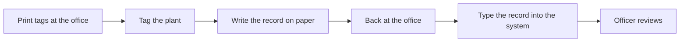
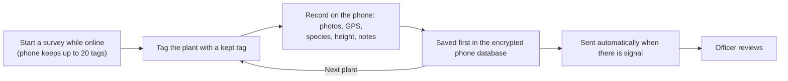

# Innovation: offline ground-truthing and quick survey mode

*CTIP-51 (Objective 5, optional), with CTIP-145 (this write-up), CTIP-146 (time per
record), CTIP-147 (quick survey mode) and CTIP-148 (field evaluation). Written 16 Nov
2026. Results in §6 are filled in after the field test.*

The brief asks for an improvement to how plants are identified, located, recorded and
managed in remote forest, then for a test that shows it works. Our improvement is the
**offline field workflow**: a botanist tags and records plants with no signal, and the
app sends everything later without losing or duplicating a record. **Quick survey mode**
builds on it to record a whole plot in one visit.

## 1. Limits of the current practice

Today at Niah, plant records are made on paper with physical tags, then typed in later
(problem statement 1 of the brief).

| # | Limit | What it costs |
|---|---|---|
| L1 | Handwritten records | Hard-to-read entries; mistakes are found only when typed in, back at the office |
| L2 | Physical tags prepared ahead | A botanist with no spare tag cannot tag the plant in front of them |
| L3 | Typing the data in later | Every record is handled twice: once in the field, once at a desk |
| L4 | The same data entered twice | Copying errors between the sheet and the database |
| L5 | Lost or damaged sheets | Rain, mud and lost notebooks mean lost records that cannot be redone |
| L6 | No signal in the forest | Any online-only app fails exactly where the work happens |
| L7 | One plant at a time | A plot of many plants means filling in the same details again and again |

## 2. Before and after

**Before: paper and printed tags**

**After: the app, with or without signal**

## 3. How each limit is answered

| Limit | What answers it | Story |
|---|---|---|
| L1 Handwritten records | Typed fields, species picked from the reference list, required photo, height check | CTIP-44, CTIP-63 |
| L2 Tags prepared ahead | Kept tags: the phone holds tag numbers made in advance and draws the QR code itself, with no signal | CTIP-116 |
| L3, L4 Typing in later, entering twice | The record made in the field is the record the officer reviews; nothing is copied | CTIP-44, CTIP-83 |
| L5 Lost sheets | Saved first in the encrypted phone database, kept through crashes and app updates, sent with no duplicates or losses | CTIP-44, CTIP-16, CTIP-66, CTIP-67 |
| L6 No signal | The whole capture works in airplane mode; species search works offline | CTIP-83, CTIP-84 |
| L7 One plant at a time | Quick survey mode: a session for the plot, up to 20 kept tags, "Next plant" with the next tag filled in, and "Next plant: same species" when a stand is one species | CTIP-147 |

How the offline part works is in [`docs/architecture/offline-sync.md`](../architecture/offline-sync.md).

**What quick survey mode never copies to the next plant:** photos, GPS, height,
appearance (morphology) and notes. Each plant must have its own, so a survey cannot
silently fill one plant's record with another's facts.

## 4. Our known limits

- **Starting a survey and signing in need a connection.** The phone must keep tags
  before going into the forest. A botanist who forgets can still record with the 3
  tags kept at all times, or with printed tags.
- **GPS under thick canopy** can be tens of metres out. The app shows the accuracy and
  lets the botanist set the spot by hand (CTIP-137); it cannot fix the satellite signal.
- **A phone lost or broken before it syncs** loses its unsent records. They are
  encrypted, so they don't leak, but they are gone.
- **The species name is the botanist's proposal.** An officer confirms it at review, as
  before.

## 5. Evaluation method (CTIP-148)

Write and agree this section with the team **before** the test.

**Plants:** the same 10 plants, or a comparable plot of 10, recorded three times by the
same botanists.

| Method | How |
|---|---|
| A. Paper | Paper form and a pre-printed tag in the field, then typed into the website later |
| B. App, single records | Airplane mode, one record at a time from Add plant |
| C. App, quick survey mode | Airplane mode, one survey session, "Next plant" between plants |

**Measured for each method**

The same start and stop points for every method, so the times compare fairly. A second
person times each plant with a stopwatch:

- **Start:** the botanist turns to the next plant (picks up the tag, the sheet or the phone).
- **Stop:** the record is finished: the paper sheet is complete (A), or the phone shows
  "Saved on this phone" (B, C).

This includes finding and scanning or picking the tag, which is the step quick survey
mode removes.

| Measure | How |
|---|---|
| Time per plant (field) | Stopwatch, start and stop as above, for A, B and C |
| Time per plant (office) | A: stopwatch while typing each record into the website. B, C: zero (nothing is typed in) |
| Form time (cross-check) | B, C: Account › Field test timings › Export CSV (CTIP-146). It times from the form opening with a tag to saving, so it is shorter than the stopwatch; use it to check the stopwatch, not as the main measure |
| Errors | Compare each record with a reference sheet made by a second person: wrong tag, missing required field, location more than 20 m out |
| Lost or duplicated records | After sync, count records in the system against plants recorded |

Run B and C in airplane mode, so no time is spent waiting for an upload.

**Proposed pass mark (to confirm with the team before the test):** method C's median
total time per plant (field plus office) is at least **30% lower** than method A's,
with **no lost or duplicated records**.

**Evidence** goes in `docs/testing/innovation/<date>/` (see the README there): the
timing CSVs, photos of the paper sheets, the reference sheet and screenshots.

Reliability with no signal is already tested in
[`docs/testing/offline-mode-test.md`](../testing/offline-mode-test.md), cases 2 (signal
lost during upload) and 3 (app killed while sending); cite those results here.

## 6. Results

*To fill in after the test.*

| Method | Plants | Median field time | Median office time | Median total | Errors | Lost / duplicated |
|---|---|---|---|---|---|---|
| A. Paper | | | | | | |
| B. App, single records | | | | | | |
| C. App, quick survey mode | | | | | | |

## 7. Discussion

*To fill in after the test: whether the pass mark was met, where the app was not better
(for example the first record, while the botanist learns the screen), and what we would
change.*
